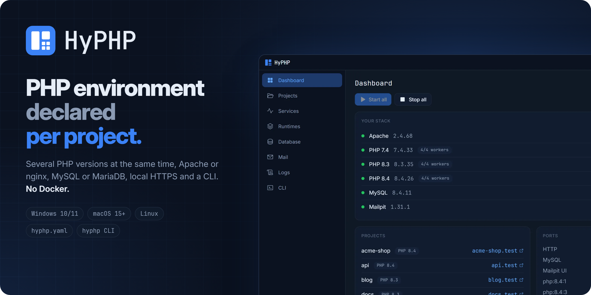

<p align="center">
  
</p>

<h1 align="center">HyPHP</h1>

<p align="center">PHP development environment for Windows and macOS.<br>Multiple PHP versions side by side, each project declares its own. No Docker.</p>

<p align="center">
  <a href="https://github.com/arismarioneves/hyphp/releases/latest"></a>
  <a href="https://github.com/arismarioneves/hyphp/actions/workflows/ci.yml"></a>
  
  <a href="LICENSE"></a>
</p>

<p align="center">
  <a href="https://ae8.com.br/hyphp/">Website</a> ·
  <a href="https://github.com/arismarioneves/hyphp/releases/latest">Download</a> ·
  <a href="#getting-started">Getting started</a> ·
  <a href="#cli">CLI</a> ·
  <a href="CONTRIBUTING.md">Contributing</a>
</p>

<p align="center"><b>English</b> | <a href="README.pt-BR.md">Português</a></p>

HyPHP is a desktop app with its own orchestrator: several PHP versions serving different
`.test` domains **at the same time**, local HTTPS, supervised workers, and an environment
declared in a `hyphp.yaml` that travels with the project. PHP, Apache or nginx, MySQL or
MariaDB, Mailpit and phpMyAdmin are downloaded, verified and supervised by the app.

## Download

| | |
|---|---|
| **Windows 10/11 x64** | [Installer](https://github.com/arismarioneves/hyphp/releases/latest) (`hyphp-<version>-windows-amd64-setup.exe`). It is not digitally signed yet: if SmartScreen warns you, choose **More info › Run anyway**. |
| **macOS 15+ on Apple Silicon** | `curl -fsSL https://github.com/arismarioneves/hyphp/releases/latest/download/install.sh \| sh` installs or updates `/Applications/HyPHP.app`. The dmg on the Releases page works too; macOS blocks the first launch of an app it has not notarized, so allow it once in **System Settings › Privacy & Security › Open Anyway**. Runtimes come from [Homebrew](https://brew.sh). |

## Why HyPHP

| Tool | Limitation |
|---|---|
| **XAMPP** | `mod_php`: one PHP version per installation. No local domains, no local HTTPS, orphan processes after a crash. |
| **Laragon** | Sound architecture, but closed, with no published source. The PHP version is switched from a menu or a *Profile*, applies to the whole installation, and is not declared in the project. |
| **WampServer** | PHP per VirtualHost through FCGI since 3.2.8 (official changelog), but Apache only, and the configuration lives in the installation's menus and files, not in the project. |
| **DDEV / Devilbox / Lando** | Solid and open source, but they require Docker: 2–4 GB of RAM before the first request. |

HyPHP brings together, on Windows and macOS and without Docker, what the others deliver
separately: **several PHP versions serving at the same time**, the version **declared in the
project itself** (`hyphp.yaml`, committable), Apache or nginx, and supervised workers.

## What it does

- **Real simultaneous multi-version.** One pool of workers per PHP version (`php-cgi` in
  FastCGI mode on Windows, `php-fpm` on macOS) behind a single Apache or nginx. Each project
  declares its version.
- **Worker pool.** On Windows `php-cgi` serves one request at a time; without a pool, one slow
  request locks up the site. Measured: 2 requests of 3 s took 6.2 s with 1 worker and 3 s
  with 2.
- **No orphan processes.** On Windows, a Job Object with kill-on-close; on macOS, a process
  group per service. Processes left behind by a crash are cleaned up at the next start.
- **Real status.** Every service has a readiness probe; the UI shows `degraded` when the
  process is alive but not responding.
- **`.test` domains and local HTTPS.** Each project answers at `<name>.test`, with a
  certificate from a local CA (mkcert) once you install it. `wildcard: true` serves
  `*.<name>.test` through the app's own DNS resolver.
- **The localhost page explains itself.** `http://localhost` lists the projects on this
  machine and, for a host that opens the wrong page, says why (a subdomain without
  `wildcard: true`, a domain outside `.test` pointing to this machine).
- **Config is output, not input.** `etc/` is generated and validated (`httpd -t` /
  `nginx -t`) before being applied; an invalid config never takes the environment down.
- **Apache or nginx, MySQL or MariaDB.** One of each active at a time, on the same ports,
  each database with its own data directory. Switching is immediate and rolls back if the new
  one does not come up.
- **Database screen.** Credentials, connection command, databases, and phpMyAdmin one click
  away. `database:` in `hyphp.yaml` creates the database if it is missing.
- **Mail stays local.** `php.ini` points `mail()` to Mailpit; the inbox is inside the app.
- **php.ini per version.** Directives such as `max_input_vars` are edited in the app for each
  PHP version, showing the effective value and where it comes from.
- **Outgoing HTTPS works on Windows.** The PHP builds for Windows ship without CA
  certificates; HyPHP keeps a bundle (Mozilla's, plus the local CA) and points `curl.cainfo`
  and `openssl.cafile` to it, so `curl`, `file_get_contents` and Composer do not fail with
  "curl error 60".
- **Runtimes from official sources.** PHP 7.2 to 8.5, Apache, nginx, MySQL, MariaDB, Mailpit,
  mkcert and phpMyAdmin are downloaded on demand and checked by SHA-256. The package catalog
  is signed and refreshed from the website every 6 hours, so a link that moved is fixed
  without a new app version.
- **CLI for the terminal and AI agents.** `hyphp status`, `hyphp start all`,
  `hyphp logs mysql -f`, `hyphp ini 8.3 max_input_vars 5000`… Every command runs in the open
  app, with `--json` output and meaningful exit codes. See [CLI](#cli).
- **Lives in the tray**, can start at login (with or without the window), in English or
  Portuguese, dark or light theme (or the system's).

## Getting started

1. **Install** and open HyPHP (see [Download](#download)).
2. **Runtimes:** download a PHP version and Apache (nginx, MySQL or MariaDB, Mailpit and
   phpMyAdmin are optional). On macOS the same screen installs them with Homebrew.
3. **Projects:** add the folder where your projects live. Every subfolder with a
   `hyphp.yaml`, a `public/index.php`, an `index.php` or a `composer.json` becomes a project
   at `<folder>.test`.
4. **Dashboard:** the warnings tell what is missing and offer the fix. The actions that need
   administrator rights (the `hosts` file and the `.test` DNS rule, the local certificate) run
   only when you click them.
5. Open `http://acme.test`. Then commit a `hyphp.yaml` so the next clone gets the same
   environment:

```yaml
name: acme
domain: acme.test          # default: <name>.test
wildcard: false            # true serves *.acme.test through the local DNS resolver
php: "8.1"                 # missing = global default version
docroot: public            # default: public if it exists, otherwise the root
extensions: [pdo_mysql, intl, zip, gd]
database: acme_dev         # created if missing
processes:
  queue: php artisan queue:work --tries=3
  scheduler: php artisan schedule:work
```

Default ports: 80 and 443 for the web server, 3306 for the database, 1025 (SMTP) and 8025
(web) for Mailpit, 8036 for phpMyAdmin. All of them can be changed in Settings.

## CLI

`hyphp` talks to the open app (on Windows through a named pipe only your user can reach; on
macOS through a socket inside the data root) and runs each command with the same services as
the window: what the CLI does shows up in the UI right away, and the **CLI** tab lists the
recent calls and who made them. Put it on your PATH from that tab.

```text
hyphp status                          version, web server, database, services, warnings
hyphp services                        services and their states
hyphp start [service|all]             starts and waits until ready (no argument: everything)
hyphp stop [service|all]              stops (no argument: everything)
hyphp restart <service>               restarts and waits until ready
hyphp logs <service> [-n 50] [-f]     last log lines; -f follows
hyphp projects                        projects, domain, PHP and folder
hyphp php | php default <series> | php use <project> <series>
hyphp ini <series> [<directive> <value> | <directive> --reset]
hyphp db | db create <name> | db drop <name> --yes | db engine <mysql|mariadb>
hyphp web <apache|nginx>              switches the web server
hyphp warnings                        stack warnings
hyphp app                             shows the window (opens the app if it is closed)
hyphp version                         CLI and app versions
hyphp help [command]                  usage
```

For scripts and AI agents: every command accepts `--json` (errors too), and the exit code is
`0` ok, `1` app error, `2` wrong usage, `3` app not running.

## Platforms

| | Windows 10/11 x64 | macOS 15+ on Apple Silicon |
|---|---|---|
| Runtimes | downloaded by the app from the official sources | installed by the app with Homebrew (`shivammathur/php` for PHP) |
| PHP workers | `php-cgi` pools (there is no `php-fpm` on Windows) | `php-fpm` |
| `.test` domains | `hosts` file; wildcard through an NRPT rule | `/etc/resolver/test` |
| Data root | next to the executable if writable, otherwise `%LOCALAPPDATA%\HyPHP` | `~/Library/Application Support/HyPHP` |
| Signature | none yet (SmartScreen warning) | ad hoc, not notarized (Gatekeeper warning on the first launch) |

`HYPHP_ROOT` overrides the data root on both. OS-specific code lives in `_windows.go` and
`_darwin.go` files.

## Stack

| Component | Versions in the catalog | License | Source |
|---|---|---|---|
| PHP | 7.2, 7.4, 8.0, 8.1, 8.2, 8.3, 8.4, 8.5 | PHP License 3.01 | windows.php.net |
| Apache httpd | 2.4 | Apache-2.0 | apachelounge.com |
| nginx | 1.30 | BSD-2-Clause | nginx.org |
| MySQL Community | 8.0, 8.4 | GPL-2.0 | dev.mysql.com |
| MariaDB Server | 10.11, 11.4, 11.8, 12.3 | GPL-2.0 | mariadb.org |
| Mailpit | 1.31 | MIT | github.com/axllent/mailpit |
| mkcert | 1.4 | BSD-3-Clause | github.com/FiloSottile/mkcert |
| phpMyAdmin | 5.2 | GPL-2.0 | phpmyadmin.net |
| CA certificates | Mozilla's bundle | MPL-2.0 | curl.se |

HyPHP does not redistribute these binaries: it downloads them on demand, verifies the
SHA-256 and extracts them into `bin/` (on macOS, Homebrew installs them). Any compatible build
placed manually in `bin/` is recognized as well. The catalog with the links and hashes lives in
[`internal/pkgmgr/catalog.json`](internal/pkgmgr/catalog.json).

Built with Go, [Wails v3](https://wails.io), React and TypeScript.

## Installation details

### Windows

The published installer installs into Program Files and asks for UAC once. Silent mode:

```powershell
hyphp-<version>-windows-amd64-setup.exe /S /D=C:\path    # directory of your choice
```

The app itself never needs privileges to run: the data root (`bin/`, `etc/`, `var/`, `log/`)
lives next to the executable if that directory is writable, otherwise in
`%LOCALAPPDATA%\HyPHP`. A per-user installer (no UAC) can be built from the source
(`INSTALL_SCOPE=user`, see [Development](#development)).

The installer ships `hyphp.exe` and `hyphp-helper.exe`. The helper performs the actions that
need administrator rights (writing to `hosts`, installing the local root certificate, the
`.test` DNS rule, installing an update); each one asks for UAC only when you click it.

Uninstalling removes the installation directory but does **not** undo what you applied to the
system: remove the `hosts` block, the `.test` DNS rule and the autostart entry from
**Settings** (the **Permissions** card and the **Start with Windows** switch) before
uninstalling.

### macOS

```bash
curl -fsSL https://github.com/arismarioneves/hyphp/releases/latest/download/install.sh | sh
curl -fsSL https://github.com/arismarioneves/hyphp/releases/latest/download/uninstall.sh | sh
```

`install.sh` checks the dmg's SHA-256 against the release manifest, closes HyPHP if it is
open and only asks for the password when `/Applications` is not writable. `uninstall.sh`
closes the app, removes the `.test` DNS rule, `/etc/paths.d/hyphp` and the trust in the mkcert
CA (asking for the administrator password), then the autostart entry, the `cli` folder and
the app. The data (databases, settings, logs) stays unless you confirm in the Terminal or run
`uninstall.sh | sh -s -- --apagar-dados`. Homebrew, its formulae and the mkcert CA files are
left alone.

### Updates

The app checks for the newest release one minute after it opens and every 6 hours (can be
turned off in the **About** tab) and downloads it in the background. The release
manifest is signed with ed25519 (public key in `internal/update/key.go`) and carries the
installer's SHA-256; the app rejects a manifest or an installer that does not match.
Installation only happens when you click **Update and restart**: the services stop, the
system asks for permission once (Windows), and the app comes back in the new version. On
macOS the app swaps its own bundle for the one in the new dmg, without a password when
`/Applications` is writable by your account; otherwise it shows the Terminal command above.

## Development

Requires Go 1.26+, Node 22+ and the Wails v3 CLI:

```bash
go install github.com/wailsapp/wails/v3/cmd/wails3@v3.0.0-beta.23
wails3 doctor     # checks the environment
wails3 dev        # development with hot reload
wails3 build      # binary in bin/
```

Packaging:

```powershell
# Windows: NSIS on PATH (winget install NSIS.NSIS installs into C:\Program Files (x86)\NSIS)
$env:PATH = 'C:\Program Files (x86)\NSIS;' + $env:PATH
wails3 task windows:package                      # bin/hyphp-amd64-installer.exe
wails3 task windows:package INSTALL_SCOPE=user   # user scope, no UAC
```

```bash
# macOS
wails3 task darwin:package       # bin/HyPHP.app (ad hoc signed, CLI and helper in Contents/Helpers)
wails3 task darwin:package:dmg   # bin/HyPHP.dmg
```

Project rules (comments, texts, tests, commits, checks before a pull request) are in
[AGENTS.md](AGENTS.md). The website lives in [`web/`](web/), with its own rules in
[web/README.md](web/README.md).

## Support the project

HyPHP is free. If it saves you time, you can support its development:

[](https://buymeacoffee.com/arismarioneves)

## License

HyPHP follows the *open core* model:

- **Everything outside `enterprise/`** is under the [MIT License](LICENSE): anyone,
  individuals or companies, can use, study, modify, share and sell it.
- **`enterprise/`** will hold the paid features, under [its own license](enterprise/LICENSE)
  and subscription-based use. Today it only contains the license: there are no paid
  features yet.

The name "HyPHP" and its logo are not covered by these licenses: a fork must use another
name and logo.

Contributions outside `enterprise/` are licensed under the MIT License; contributions to
`enterprise/` follow the [CLA](CLA.md). See [CONTRIBUTING.md](CONTRIBUTING.md). The
components HyPHP downloads (table in [Stack](#stack)) each follow their own license.
